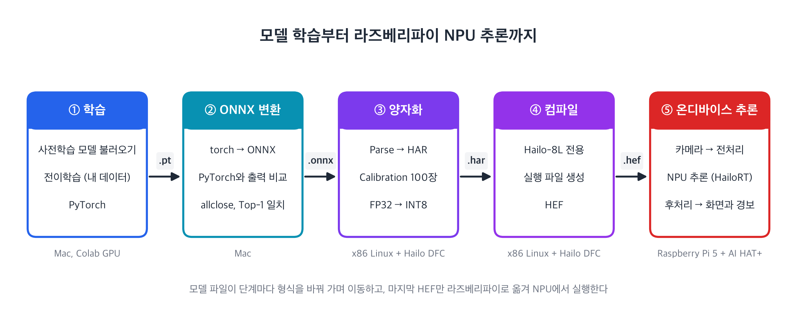
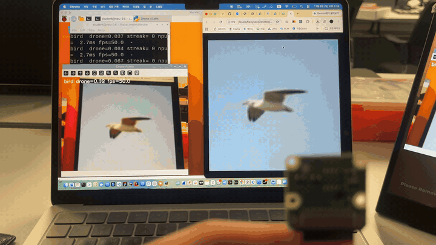
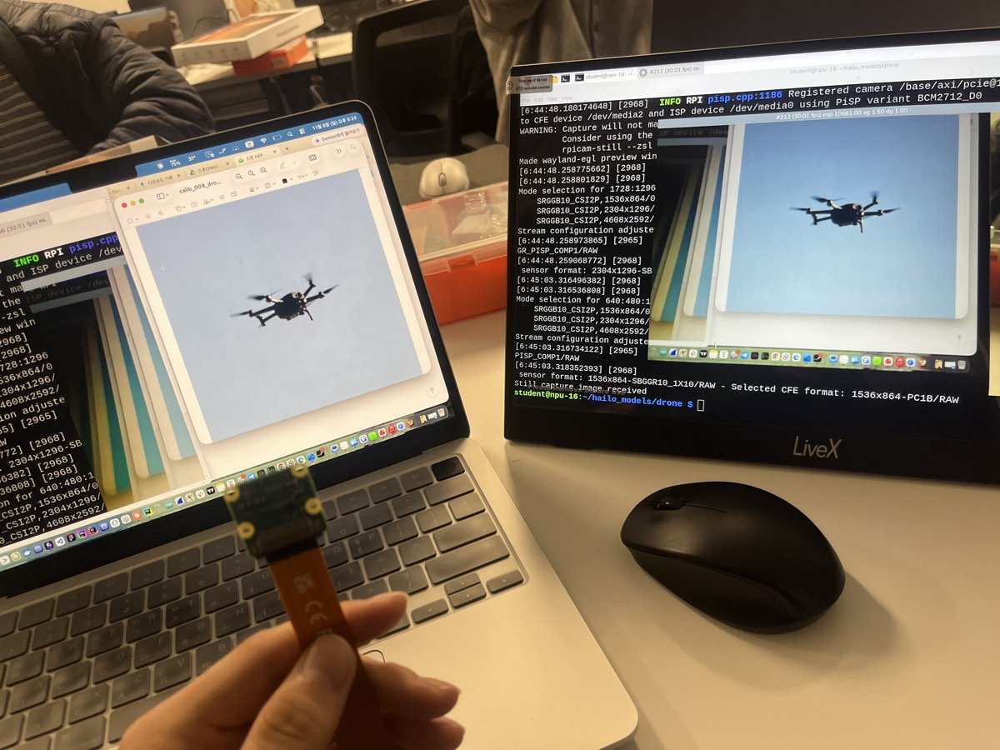
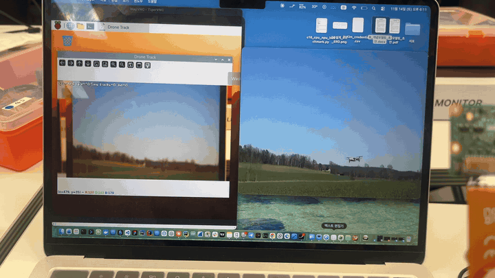
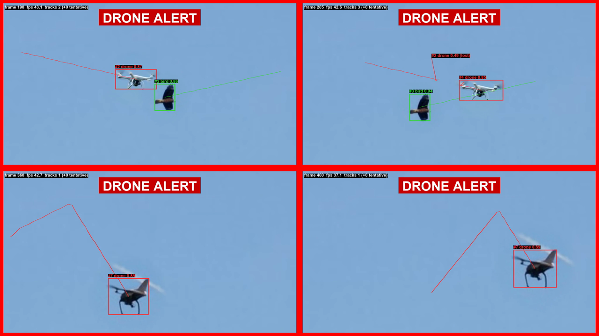
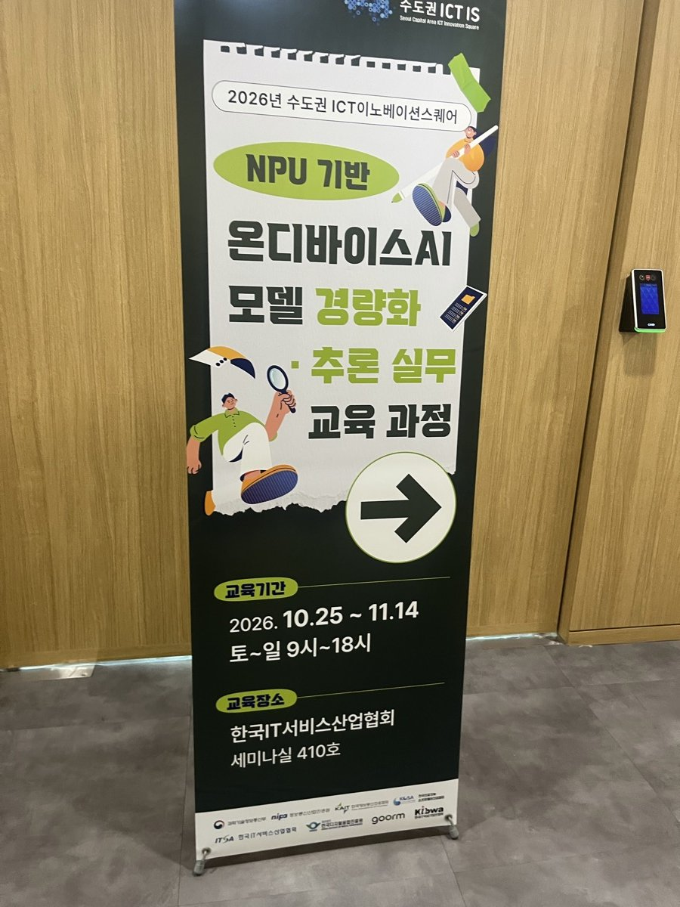
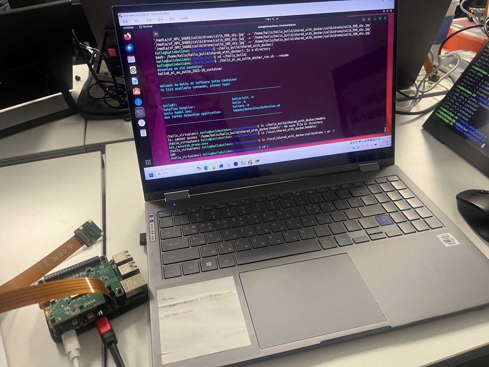

# NPU 기반 온디바이스 AI

**2026 수도권 ICT 이노베이션스퀘어 인공지능(NPU) 과정 실습 저장소**

## 파이프라인

  

 

## 프로젝트 1. 드론 경보 분류

카메라 화면 전체를 보고 드론, 새, 빈 하늘 가운데 하나로 판별해 드론일 때 경보를 띄웁니다.

  
   
  

| 항목 | 내용 |
|---|---|
| 모델 | ResNet18 전이학습, 3클래스 |
| 데이터 | drone vs bird 합성 사진 6,000장 (CC BY 4.0) |
| 검증 정확도 | 96.33% |
| NPU 결과 | 카메라로 찍은 드론 사진 drone 0.966 (PC ONNX 0.969) |
| 코드 | [`DRONE_LAB/`](DRONE_LAB) |

 

## 프로젝트 2. 드론 탐지와 추적

드론에 박스를 치고 번호를 붙여 움직임을 따라가며, 같은 드론이 일정 시간 이상 잡히면 경보를 띄웁니다.

  
   
  

| 항목 | 내용 |
|---|---|
| 모델 | YOLOv8n 전이학습, 4클래스 (drone, bird, airplane, helicopter) |
| 학습 | Colab T4 GPU, mAP50 0.845 |
| 추적 | 칼만 필터로 다음 위치를 예측하고 IoU로 짝을 지어 번호 유지 |
| NPU 속도 | 단독 104 FPS, 카메라부터 화면까지 약 45 FPS |
| 컴파일 | AWS EC2(x86 Ubuntu)에서 Hailo DFC 3.33 |
| 코드 | [`DRONE_TRACK/`](DRONE_TRACK) |

 

## 실습 현장

  
  

## 실습 장비

| 장비 | 역할 |
|---|---|
| Raspberry Pi 5 8GB | 추론 본체 |
| AI HAT+ (Hailo-8L, 13 TOPS) | NPU |
| Camera Module 3 | 영상 입력 |

## 폴더

| 폴더 | 내용 |
|---|---|
| `C03` ~ `ch09` | 차시별 실습 (추론, Latency, ONNX 변환, 양자화, HEF) |
| `NPU_LAB/ADD` | 고양이와 강아지 전이학습 |
| `DRONE_LAB` | 프로젝트 1 |
| `DRONE_TRACK` | 프로젝트 2 |
