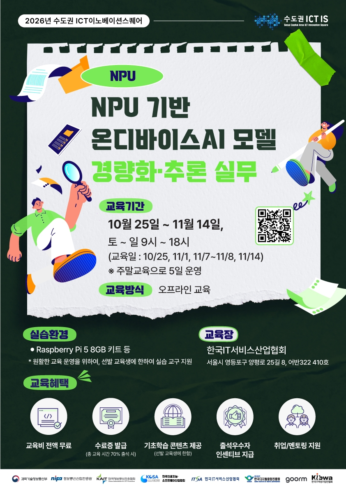
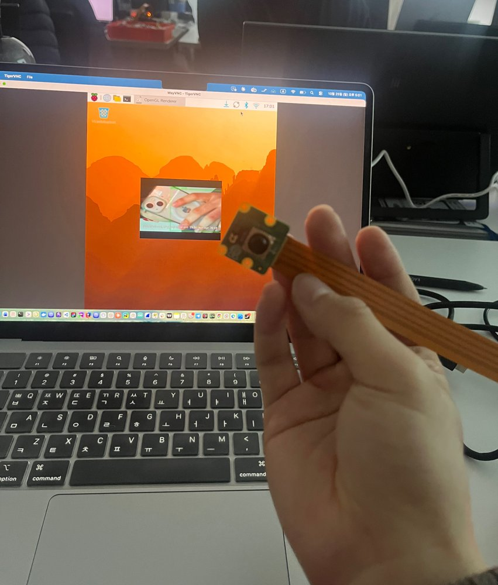

<div align="center">

# NPU 기반 온디바이스 AI 모델 경량화 및 추론 실무

**2026 수도권 ICT 이노베이션스퀘어 확산사업 인공지능(NPU) 과정 실습 저장소**


</div>

<br>

## 📌 과정 소개

이 저장소는 클라우드가 아닌 기기 안에서 AI 모델을 돌리는 온디바이스 AI를 다루는 40시간 과정의 실습 코드와 정리 노트를 모아 둔 곳입니다. 과정은 사전학습 모델을 ONNX로 변환하고 FP16과 INT8로 경량화한 뒤, Raspberry Pi 5에 장착한 NPU 가속기에서 추론하여 CPU 대비 성능을 비교하는 흐름으로 진행됩니다.

<div align="center">
  
</div>

<br>

## 🧰 실습 장비

과정에서 지원받은 장비는 Raspberry Pi 5 보드와 NPU 가속기, 카메라 모듈로 구성되며, 이 장비 위에서 카메라 입력을 받아 실시간으로 추론하는 실습을 합니다.

| 장비 | 역할 |
|---|---|
| Raspberry Pi 5 8GB 스타트키트 | 추론을 실행하는 본체 보드 |
| Raspberry Pi AI HAT+ 13 TOPS | 모델 추론을 가속하는 NPU 모듈 |
| Raspberry Pi Camera Module 3 | 실시간 이미지 입력 |

<br>

## 🗓️ 커리큘럼

1주차에는 NPU 실행 환경을 갖추고 모델을 ONNX로 변환해 검증하는 기초를 다루며, 2주차에는 그 모델을 경량화해 NPU에 배포하고 성능을 비교한 뒤 응용 프로젝트로 마무리합니다.

### 1주차 온디바이스 추론 기초

| 차시 | 주제 | 주요 내용 | 방식 |
|:---:|---|---|:---:|
| 1-1 | 온디바이스 AI와 Raspberry Pi NPU 이해 | Cloud AI와 On-device AI 비교, CPU와 GPU와 NPU의 역할 차이, 메모리와 전력 제약 | 이론 |
| 1-2 | NPU 실행환경 구성 및 점검 | AI HAT+ 연결 구조, NPU Driver와 Runtime, 장치 인식 확인, 카메라 입출력 점검 | 이론, 실습 |
| 1-3 | AI 추론 파이프라인 | 이미지와 카메라 입력, Resize와 Normalize, Tensor 변환, CPU와 NPU Baseline 측정 | 이론, 실습 |
| 1-4 | ONNX 변환 및 검증 | ONNX Export, 입출력 Shape와 Opset, ONNX Runtime 실행, 변환 전후 Latency 비교 | 이론, 실습 |
| 1-5 | 모델 입출력 구조와 배포 오류 분석 | NCHW와 NHWC, RGB와 BGR, 전처리 불일치로 생기는 오류 분석 및 해결 | 이론, 실습 |

### 2주차 경량화와 NPU 배포

| 차시 | 주제 | 주요 내용 | 방식 |
|:---:|---|---|:---:|
| 2-1 | FP32, FP16, INT8 모델 경량화 | FP16 변환, INT8 Quantization, Calibration, 경량화 전후 모델 크기 비교 | 이론 |
| 2-2 | NPU용 모델 변환 및 배포 | NPU 지원 연산, Quantization과 Compile 구조, NPU 실행모델 생성 및 배포 | 이론 |
| 2-3 | CPU와 NPU 성능 비교 | 동일 조건 Benchmark, 정밀도별 Latency와 FPS와 정확도 변화 분석 | 이론, 실습 |
| 2-4 | 추론 파이프라인 최적화 | 입력 해상도, Camera FPS, Frame Sampling, End to End Latency 최적화 | 이론, 실습 |
| 2-5 | 온디바이스 AI 응용 프로젝트 | 변환과 경량화와 NPU 추론을 하나의 파이프라인으로 통합한 응용 구현 및 발표 | 실습 |

<br>

## 🎥 실습 기록

C02 실습에서는 Camera Module 3로 받은 영상을 Hailo-8L NPU로 추론해 실시간 객체 탐지를 실행했습니다. 모니터 없이 맥북에서 SSH로 명령을 입력하고 라즈베리파이 화면은 VNC로 받아 보았으며, 탐지 결과 창의 크기를 640×360으로 줄이고 카메라 입력을 15 FPS로 맞춰 화면 지연을 줄였습니다.

<div align="center">
  
</div>

<br>

## 📁 폴더 구조

```
.
├── day1/
│   └── test.py          # 패키지 설치 확인
├── 명령어_복습.md        # 터미널, venv, pip 명령어 정리
├── requirements.txt
└── README.md
```

<br>

## ⚙️ 개발 환경 설정

Raspberry Pi에 배포하기 전 단계인 모델 변환과 검증은 노트북에서 진행하므로, 노트북에는 Python 3.12 가상환경을 만들고 CUDA 없이 동작하는 CPU 전용 PyTorch를 설치했습니다.

```bash
# 가상환경 생성 및 활성화 (Windows는 npu_env\Scripts\activate)
python -m venv npu_env
source npu_env/bin/activate

# 패키지 설치
pip install -r requirements.txt
pip install torch==2.12.0 --index-url https://download.pytorch.org/whl/cpu

# 설치 확인
python day1/test.py
```

| 패키지 | 용도 |
|---|---|
| torch 2.12.0 | 사전학습 모델 로드와 ONNX Export |
| onnx, onnxscript | ONNX 모델 생성과 검증 |
| onnxruntime | 변환한 모델의 CPU 추론과 Latency 측정 |
| numpy, pandas, matplotlib | 전처리, 결과 정리, 성능 비교 그래프 |
| scikit-learn, pillow | 평가 지표 계산과 이미지 입력 처리 |
